# toon-explainer

Turn a narrated script into a cutout-cartoon explainer video with a coding agent. toon-explainer is a skill and a portable HTML Canvas engine for the look of history and science YouTube channels: bean-head characters in three-quarter view, painted skies, foreground framing, bold outlined lettering, maps, crowds, fire, rain and punch zooms.

**Script → JSON spec → deterministic Canvas render → MP4**

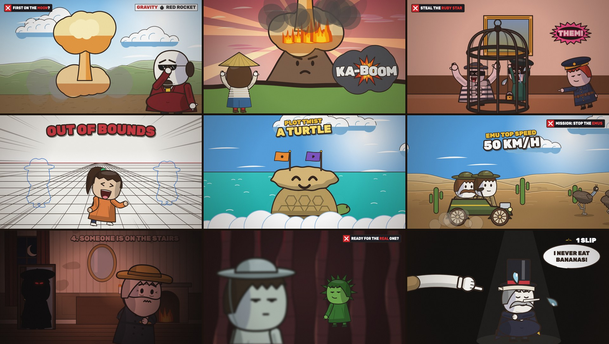

[Quick start](#quick-start) · [Showcase](#showcase) · [Gallery](https://hostlife22.github.io/toon-explainer/) · [Toolkits for any topic](#toolkits-for-any-topic) · [What the engine draws](#what-the-engine-draws) · [From script to film](#from-script-to-film) · [Documentation](#documentation)

## Quick start

### Use with your coding agent

Install the skill:

```sh
npx skills add Hostlife22/toon-explainer
```

Give your agent a storyboard and a brief:

> Use toon-explainer to animate this script. Cold, investigative tone, 3/4-view characters, a foreground plane in every shot. Render a contact sheet first.

The [skill](SKILL.md) turns each storyboard shot into a spec shot, picks a shot recipe for every line, renders a contact sheet for review and then the film. It also re-times the film to a recorded voiceover.

### Render locally

Install [uv](https://docs.astral.sh/uv/) and FFmpeg, then clone the repository and install Chromium:

```sh
git clone https://github.com/Hostlife22/toon-explainer.git
cd toon-explainer
uv run --with playwright playwright install chromium
```

Preview an example in the browser (space plays, arrow keys step frames):

```sh
uv run --with playwright python scripts/render.py examples/showcase/spec.json --serve
```

Render a contact sheet and a video:

```sh
uv run --with playwright python scripts/render.py examples/showcase/spec.json --sheet renders/sheet.jpg
uv run --with playwright python scripts/render.py examples/showcase/spec.json --out renders/showcase.mp4 --workers 4
```

The renderer starts its own local server. Use `--scale 0.5` for fast previews, `--shot <id>` to render one shot and `--audio vo.mp3` to mux a voiceover.

## Showcase

All frames below were rendered by the engine from the specs in [`examples/`](examples/). The GIFs are silent and loop. Every picture is listed in [`assets/media.json`](assets/media.json) and rebuilt from the current engine with `uv run --with playwright --with pillow python scripts/make_media.py`. The [gallery](https://hostlife22.github.io/toon-explainer/) ([`gallery.html`](gallery.html) in a clone) shows all of them full size, each with buttons to its spec, storyboard and contact sheet.

### Story films

Twelve short films on topics far from history, each built to tell a real story with a twist while using as much of the engine as it can.

<table>
<tr>
<td width="50%" valign="top">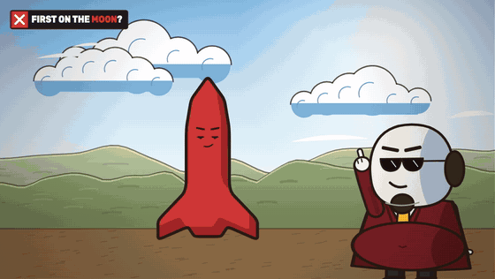<br/><strong><a href="examples/story_moon_race/script.md">The Race to the Moon</a></strong> · rivals, mushroom boom, countdown, a punch that fixes the engine, a one-planet twist</td>
<td width="50%" valign="top">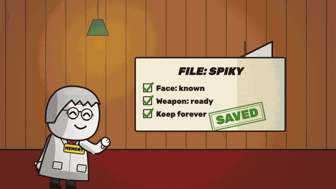<br/><strong><a href="examples/story_vaccine/script.md">How a Vaccine Trains Your Body</a></strong> · blueprint erase, wanted poster, rack-focus flashback, brawl, K.O.</td>
</tr>
<tr>
<td width="50%" valign="top">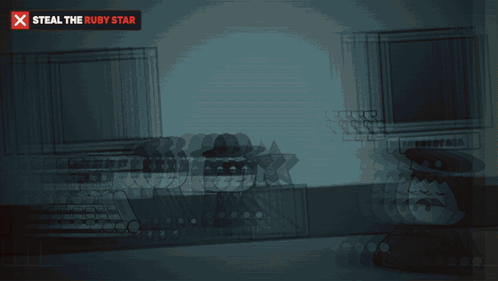<br/><strong><a href="examples/story_museum_heist/script.md">The Museum Heist</a></strong> · CCTV, claw crane, poof disguise, alarm strobe, a double-cross</td>
<td width="50%" valign="top">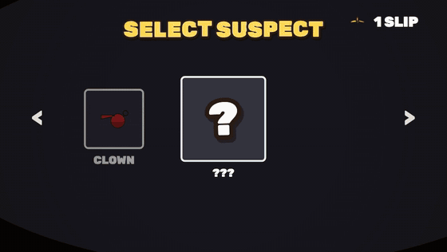<br/><strong><a href="examples/story_banana_caper/script.md">Who Left the Banana Peel?</a></strong> · carousel snap, liar nose, comic-grid recap, slapstick payoff</td>
</tr>
<tr>
<td width="50%" valign="top">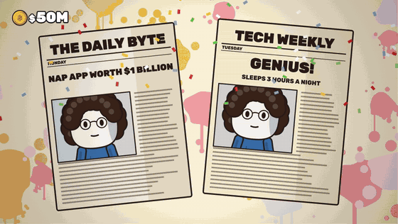<br/><strong><a href="examples/story_startup/script.md">Rise and Fall of a Startup</a></strong> · carousel snap, draining meter, error popups, loading forever, cobwebs</td>
<td width="50%" valign="top">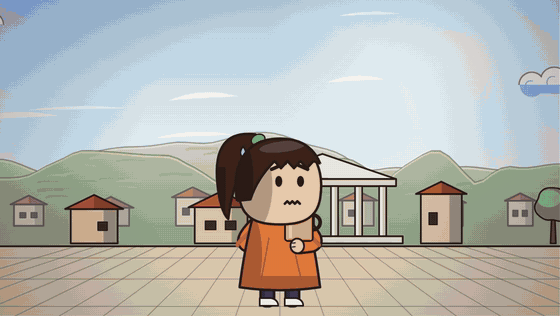<br/><strong><a href="examples/story_simulation/script.md">What If We Live in a Simulation?</a></strong> · hatch collapse, grid void, line art, cursor delete, CRT pull-back</td>
</tr>
<tr>
<td width="50%" valign="top">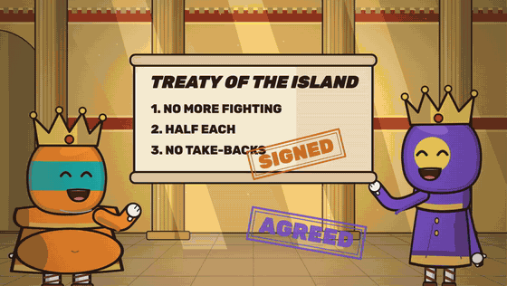<br/><strong><a href="examples/story_border/script.md">The Island Nobody Wanted</a></strong> · region prop, map split, treaty stamps, a turtle twist</td>
<td width="50%" valign="top">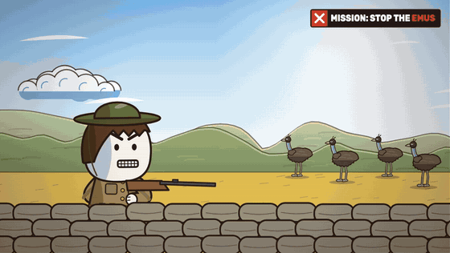<br/><strong><a href="examples/story_emu_war/script.md">The Great Emu War</a></strong> · error popup gag, vehicle chase, map fights and conquest</td>
</tr>
<tr>
<td width="50%" valign="top">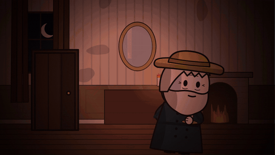<br/><strong><a href="examples/story_lighthouse/script.md">The Last Lighthouse Keeper</a></strong> · horror grade, lurker, wall shadow, jump scare, eyelids, ghost</td>
<td width="50%" valign="top">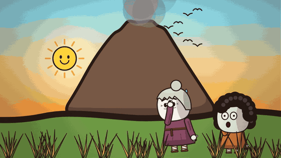<br/><strong><a href="examples/story_volcano/script.md">Why Volcanoes Erupt</a></strong> · accel time-lapse, eruption, inferno grade, running crowd</td>
</tr>
<tr>
<td width="50%" valign="top"><table><tr><td width="50%" valign="top">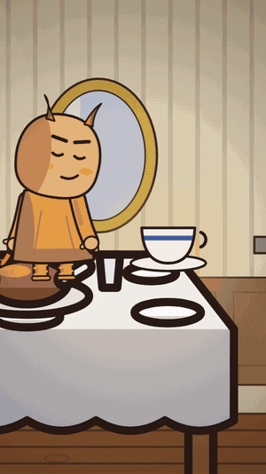<br/><strong><a href="examples/story_cat_physics/script.md">Why Cats Knock Things Off Tables</a></strong> · slow-mo, crash, rage</td><td width="50%" valign="top">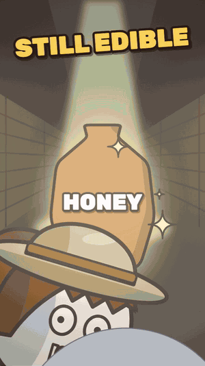<br/><strong><a href="examples/story_honey/script.md">The Honey That Never Spoils</a></strong> · time-lapse, bee, picture bubble</td></tr></table></td>
<td width="50%" valign="top"><strong>Two vertical shorts (9:16).</strong> Every story above is a short film in <code>examples/story_*</code> with a storyboard (<code>script.md</code>) and a spec, written from a one-line premise with the <a href="references/09-directing.md">directing method</a>: a hook, rising tension, a turn and a payoff. Each GIF is one 6–9 s stretch of its film; the <a href="#contact-sheets">contact sheets</a> show every shot.</td>
</tr>
</table>

### Classic scenes

<table>
<tr>
<td width="50%"><br/><strong>Forest march</strong> · crowd on twos, rain onset, grade</td>
<td width="50%"><br/><strong>Palace</strong> · over-the-shoulder, hold-and-snap pose, talking mouth</td>
</tr>
<tr>
<td width="50%"><br/><strong>City on fire</strong> · flipbook fire, smoke, explosion, tremble</td>
<td width="50%"><br/><strong>Messenger</strong> · run cycle, lagging cape, foreground grass parallax</td>
</tr>
<tr>
<td width="50%"><br/><strong>Map</strong> · extruded territories, coastal glow, dot army</td>
<td width="50%"><br/><strong>Numbers</strong> · flipping calendar, counter, punch zoom</td>
</tr>
</table>

## Toolkits for any topic

The style grammar was learned from eight studied explainer videos: Rome, China, the Reconquista, World War I, the road to World War II, a speech fact-check show, a Greek myth and a horror biography. Each one added a toolkit, so one engine covers wars of every era, long dynastic histories, mythology, fact-checks and horror. The [reference library](references/06-reference-library.md) maps each film type to its backgrounds, characters, graphics and tone tools.

<table>
<tr>
<td width="33%"><br/><strong>World War I</strong> · trenches, no-man's-land, uniforms</td>
<td width="33%"><br/><strong>Vehicles</strong> · tank, train, ships, biplane, cannon</td>
<td width="33%"><br/><strong>Medieval</strong> · great helms, horses, gallop on twos</td>
</tr>
<tr>
<td width="33%"><br/><strong>Living maps</strong> · faces, weapon arms, fronts, conquests</td>
<td width="33%"><br/><strong>Nations as people</strong> · flag heads, era headwear</td>
<td width="33%"><br/><strong>East Asia</strong> · pagodas, eaves, hanfu, karst mist</td>
</tr>
<tr>
<td width="33%"><br/><strong>Fact-check</strong> · TV quote player, flagged subtitles, stamps</td>
<td width="33%"><br/><strong>Horror</strong> · lurker, heavy vignette, slow dread</td>
<td width="33%"><br/><strong>Time compression</strong> · day/night time-lapse, timeline HUD, year signs</td>
</tr>
</table>

## Directing and vertical shorts

A third pass studied twenty videos by the channel, eight long films and twelve vertical shorts. Every frame was decoded for cut detection, contact sheets covered each video end to end, and 274 frame strips were cut at 30 fps (coverage in [06-reference-library](references/06-reference-library.md)). It added a planning method, [09-directing](references/09-directing.md): topic → central question → arc → meaning events → visible actions → shot cards. It also added a [technique library](references/10-technique-library.md) indexed by what a scene must do, and a 9:16 format ([11-vertical-shorts](references/11-vertical-shorts.md); `"format": "vertical"`). Two films built with the method show it on non-historical topics: [`examples/vertical_short`](examples/vertical_short/spec.json) ("Why Ice Floats", 9:16) and [`examples/money_film`](examples/money_film/spec.json) ("Why Printing Money Raises Prices", 16:9).

<table>
<tr>
<td width="25%" valign="top">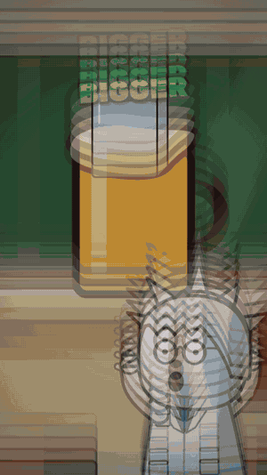<br/><strong><a href="examples/vertical_short/script.md">Why Ice Floats</a></strong> · 9:16, pinned captions, shot frame</td>
<td width="75%" valign="top">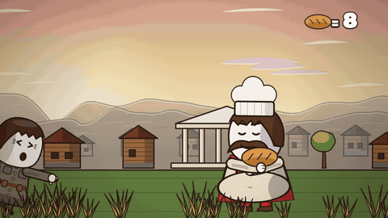<br/><strong><a href="examples/money_film/script.md">Why Printing Money Raises Prices</a></strong> · counters, charts, crowds</td>
</tr>
</table>

## Acting, staging and story

A second, frame-dense pass over the same eight videos (1 frame per second, motion strips, transcripts) filled in acting, staging and story tools, collected in the [toolkit cards](references/08-toolkits.md) and a [story-craft guide](references/07-story-craft.md) that maps narration to shot recipes. The film below was made by an agent that had only the skill's docs and a one-paragraph brief: [`examples/coffee_film`](examples/coffee_film/spec.json), "How Coffee Conquered the World", 24 shots, 73 s.

<table>
<tr>
<td colspan="3"><br/><strong>A whole film from a brief</strong> · rack focus, swap, stamps, a running counter and quest chip across cuts</td>
</tr>
<tr>
<td width="33%"><br/><strong>Acting and gags</strong> · poof swaps, giant arms, hat gags, marks</td>
<td width="33%"><br/><strong>Living maps</strong> · split, shatter, tilt and globe views, war arrows</td>
<td width="33%"><br/><strong>Places</strong> · palaces, studios, rooms, harbor, mood backdrops</td>
</tr>
<tr>
<td width="33%"><br/><strong>Lens</strong> · split screens, comic grids, 33 transitions, POV masks</td>
<td width="33%"><br/><strong>FX</strong> · brawl cloud, materials, stand-ins, booms, 25 grades</td>
<td width="33%"><br/><strong>Game parodies</strong> · HUD, cursor, VS cards, menus, quest chips</td>
</tr>
<tr>
<td width="33%"><br/><strong>Paper and lettering</strong> · picture bubbles, nameplates, stat cards, graffiti</td>
<td width="33%"><br/><strong>Characters</strong> · 35 expressions, 65 poses, 58 headwear, 29 outfits, ages and builds</td>
<td width="33%" valign="top"><br/><strong>Every feature has a demo film</strong>: each <a href="references/08-toolkits.md">toolkit card</a> names its catalog film in <code>examples/</code>, one shot per feature. Render any of them with <code>--sheet</code> to browse the toolkit.</td>
</tr>
</table>

### More of the toolkit

One GIF per newer feature, taken from the catalog films (each toolkit card names its film).

<table>
<tr>
<td width="33%" valign="top">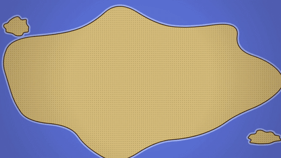<br/><strong>Map fights</strong> · a brawl cloud travels a path with trail and drops</td>
<td width="33%" valign="top">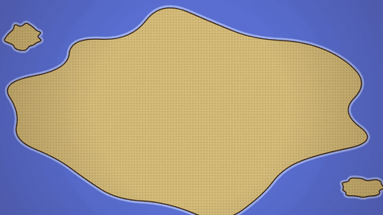<br/><strong>Map throws</strong> · icons thrown along an arc</td>
<td width="33%" valign="top"><br/><strong>Region prop</strong> · one map region as an object</td>
</tr>
<tr>
<td width="33%" valign="top">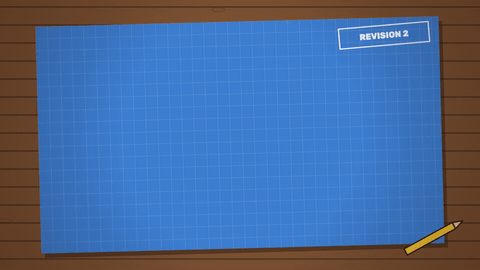<br/><strong>Blueprint erase</strong> · item out, bg clear</td>
<td width="33%" valign="top">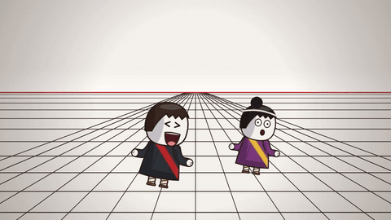<br/><strong>Grid</strong> · the simulation floor</td>
<td width="33%" valign="top">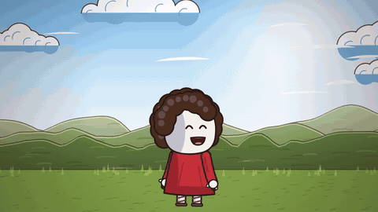<br/><strong>Hatch</strong> · render collapse</td>
</tr>
<tr>
<td width="33%" valign="top">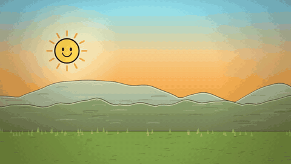<br/><strong>Accelerating time-lapse</strong> · accel and dayDur keys</td>
<td width="33%" valign="top">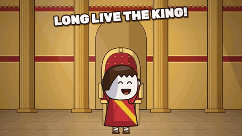<br/><strong>Burn</strong> · transition</td>
<td width="33%" valign="top">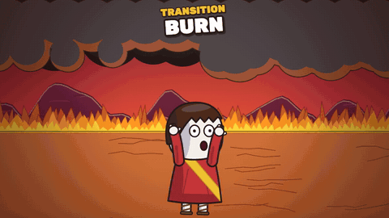<br/><strong>Swarm</strong> · transition</td>
</tr>
<tr>
<td width="33%" valign="top">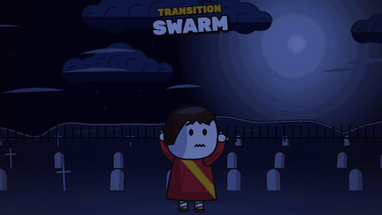<br/><strong>Swirl</strong> · transition</td>
<td width="33%" valign="top">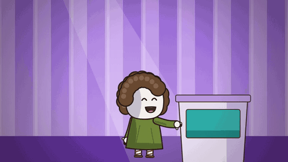<br/><strong>Corrupt glitch</strong> · row tears, black-out</td>
<td width="33%" valign="top">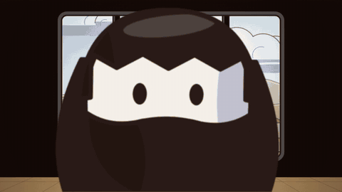<br/><strong>Vertical fg-pass</strong> · a figure rises past the lens</td>
</tr>
<tr>
<td width="33%" valign="top">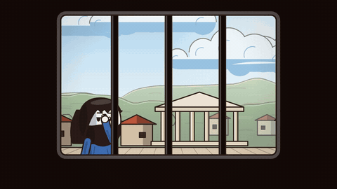<br/><strong>Aperture</strong> · a window in a dark frame</td>
<td width="33%" valign="top">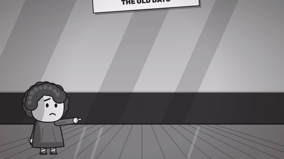<br/><strong>Photo panel</strong> · print frame, mono grade</td>
<td width="33%" valign="top">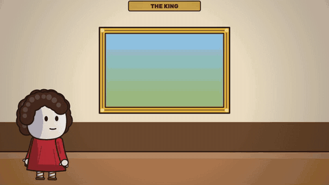<br/><strong>Crack</strong> · cracked glass</td>
</tr>
<tr>
<td width="33%" valign="top">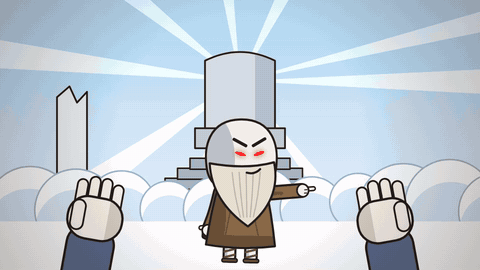<br/><strong>Petrify</strong> · the viewer turns to stone</td>
<td width="33%" valign="top">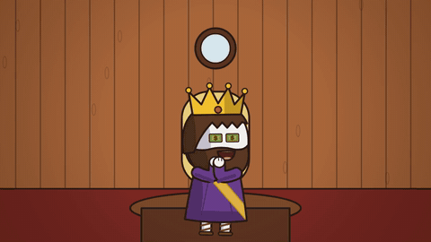<br/><strong>Pile</strong> · a fill that buries the frame</td>
<td width="33%" valign="top">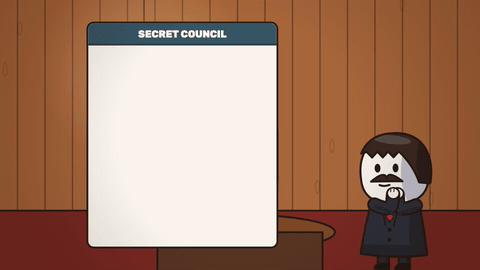<br/><strong>Chat</strong> · messenger thread</td>
</tr>
<tr>
<td width="33%" valign="top">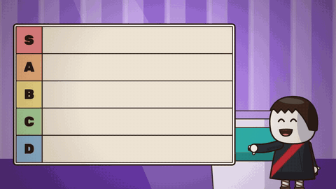<br/><strong>Tier list</strong> · ranking card</td>
<td width="33%" valign="top">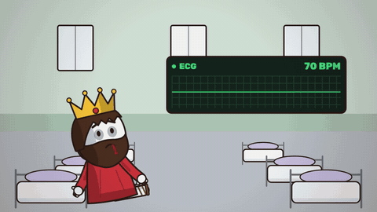<br/><strong>ECG</strong> · heart monitor, flatline</td>
<td width="33%" valign="top">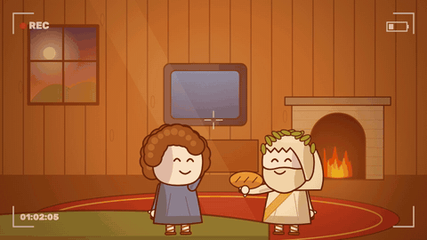<br/><strong>Camcorder</strong> · cctv variant</td>
</tr>
<tr>
<td width="33%" valign="top">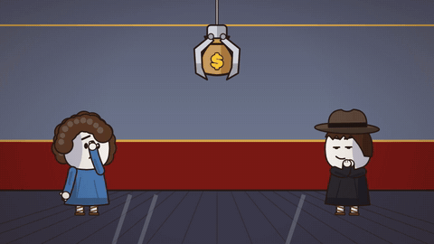<br/><strong>Claw crane</strong> · load, release, rise</td>
<td width="33%" valign="top">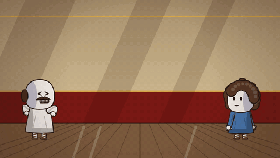<br/><strong>Meat grinder</strong> · feed, crank, sausage</td>
<td width="33%" valign="top">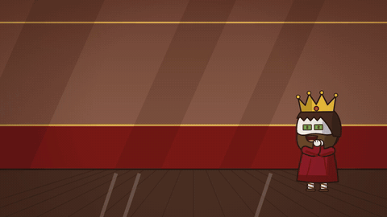<br/><strong>Coin gavel</strong> · justice for sale</td>
</tr>
<tr>
<td width="33%" valign="top">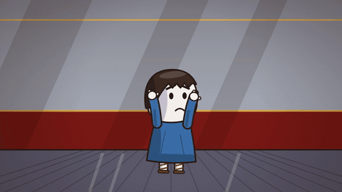<br/><strong>Smear</strong> · hair smear on a sharp turn</td>
<td width="33%" valign="top">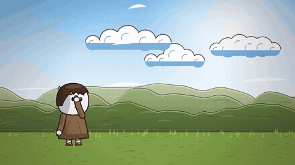<br/><strong>Drop shadow</strong> · shadow before a drop</td>
<td width="33%" valign="top">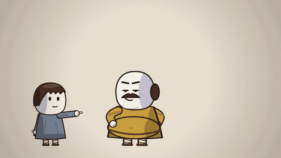<br/><strong>X-ray</strong> · layer modifier</td>
</tr>
</table>

### Contact sheets

One still per shot of every example film. Render any of them yourself with `--sheet`.

<details>
<summary>Story films</summary>

**banana caper** · [`examples/story_banana_caper`](examples/story_banana_caper/spec.json)

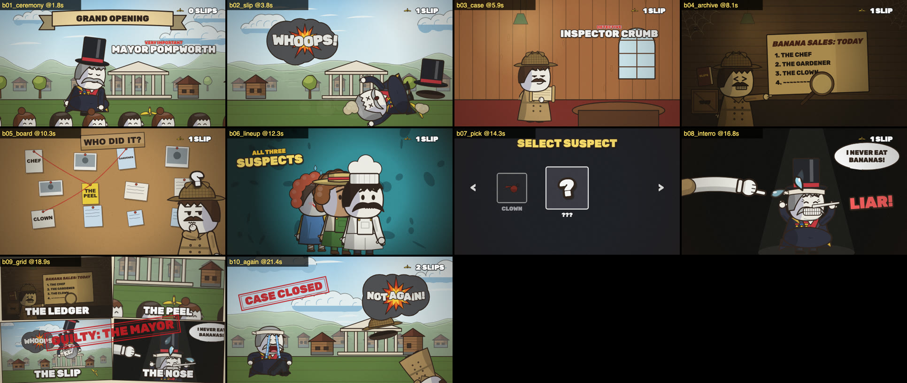

**border** · [`examples/story_border`](examples/story_border/spec.json)

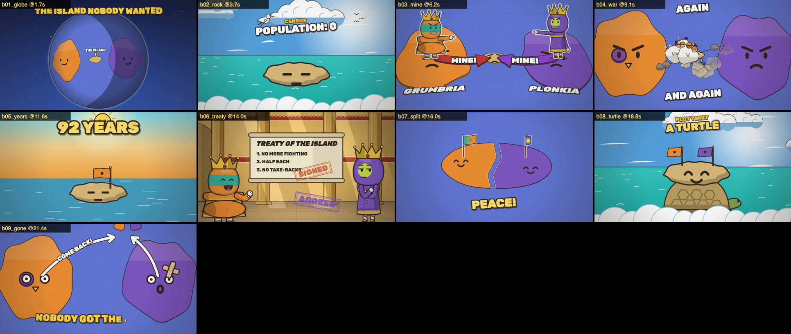

**cat physics** · [`examples/story_cat_physics`](examples/story_cat_physics/spec.json)

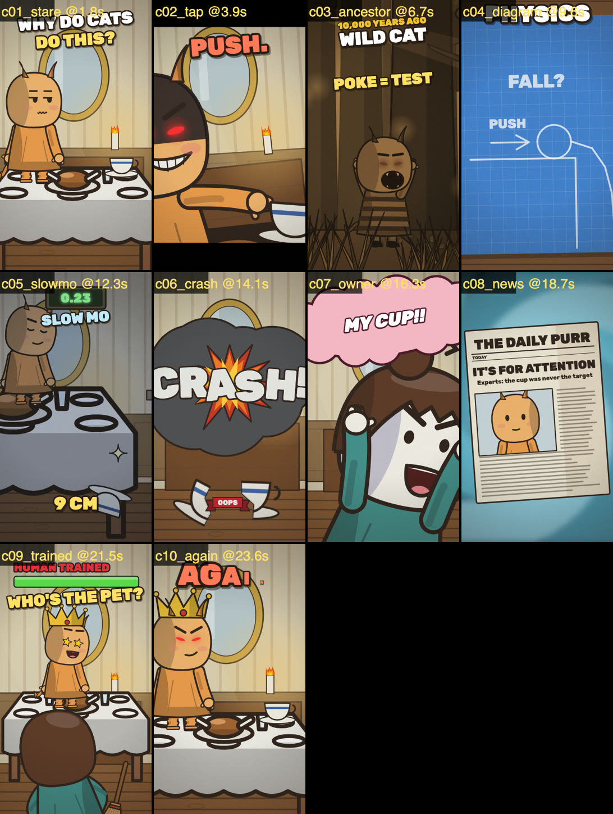

**emu war** · [`examples/story_emu_war`](examples/story_emu_war/spec.json)

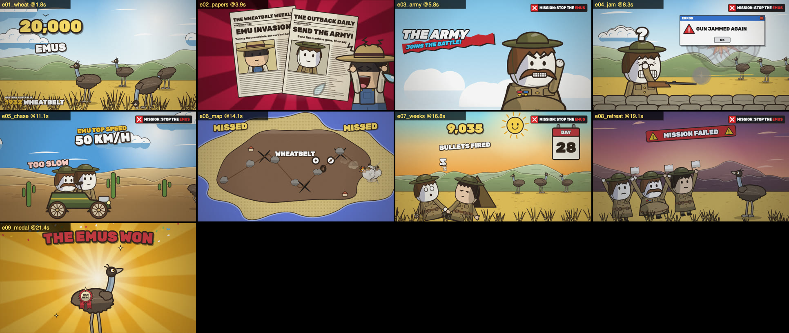

**honey** · [`examples/story_honey`](examples/story_honey/spec.json)

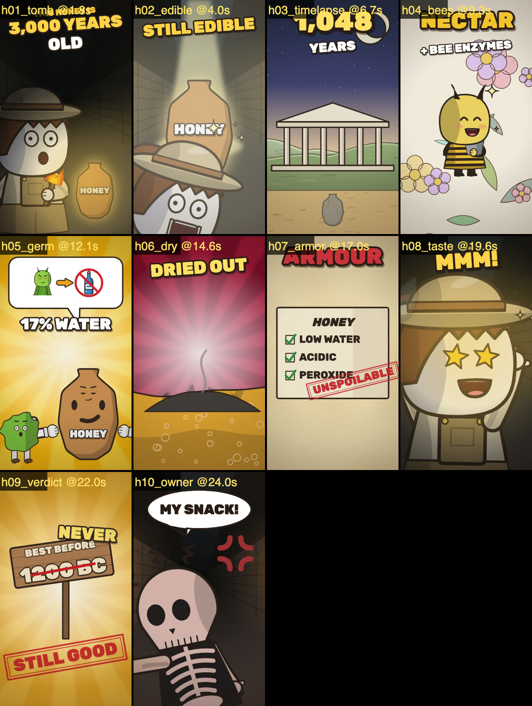

**lighthouse** · [`examples/story_lighthouse`](examples/story_lighthouse/spec.json)

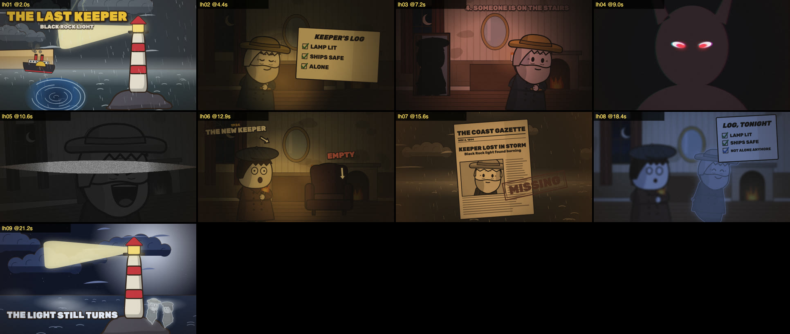

**moon race** · [`examples/story_moon_race`](examples/story_moon_race/spec.json)

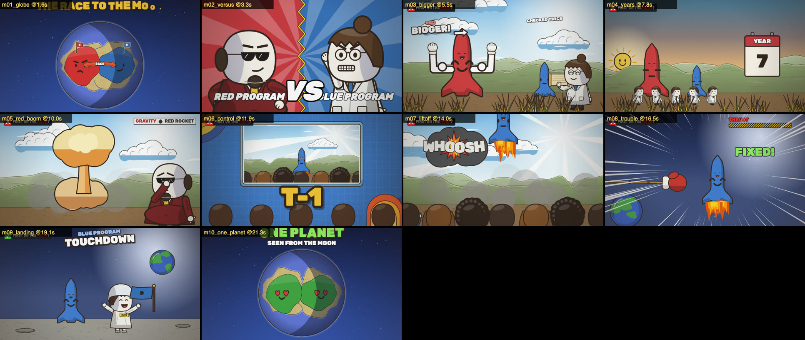

**museum heist** · [`examples/story_museum_heist`](examples/story_museum_heist/spec.json)

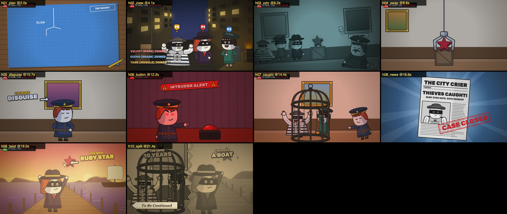

**simulation** · [`examples/story_simulation`](examples/story_simulation/spec.json)

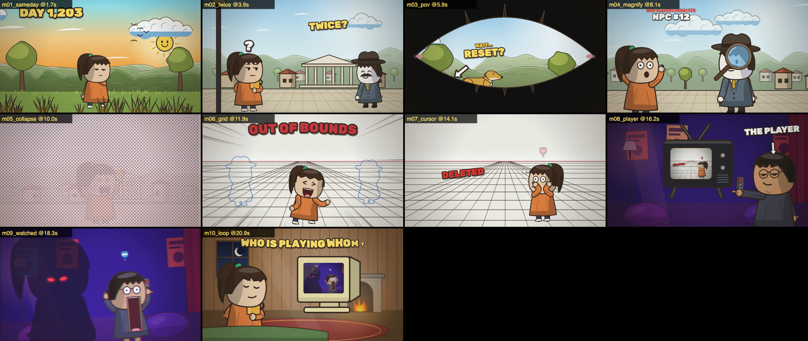

**startup** · [`examples/story_startup`](examples/story_startup/spec.json)


**vaccine** · [`examples/story_vaccine`](examples/story_vaccine/spec.json)


**volcano** · [`examples/story_volcano`](examples/story_volcano/spec.json)


</details>

<details>
<summary>Catalog and method films</summary>

**acting gags** · [`examples/acting_gags`](examples/acting_gags/spec.json)


**action fx** · [`examples/action_fx`](examples/action_fx/spec.json)


**calendar 445** · [`examples/calendar_445`](examples/calendar_445/spec.json)


**coffee film** · [`examples/coffee_film`](examples/coffee_film/spec.json)


**eras wardrobe** · [`examples/eras_wardrobe`](examples/eras_wardrobe/spec.json)


**expressions wardrobe** · [`examples/expressions_wardrobe`](examples/expressions_wardrobe/spec.json)


**game ui** · [`examples/game_ui`](examples/game_ui/spec.json)


**grammar** · [`examples/grammar`](examples/grammar/spec.json)


**living maps** · [`examples/living_maps`](examples/living_maps/spec.json)


**money film** · [`examples/money_film`](examples/money_film/spec.json)


**paper and maps** · [`examples/paper_and_maps`](examples/paper_and_maps/spec.json)


**paper cards** · [`examples/paper_cards`](examples/paper_cards/spec.json)


**places tour** · [`examples/places_tour`](examples/places_tour/spec.json)


**props creatures** · [`examples/props_creatures`](examples/props_creatures/spec.json)


**sets rooms** · [`examples/sets_rooms`](examples/sets_rooms/spec.json)


**showcase** · [`examples/showcase`](examples/showcase/spec.json)


**tone and horror** · [`examples/tone_and_horror`](examples/tone_and_horror/spec.json)


**transitions lens** · [`examples/transitions_lens`](examples/transitions_lens/spec.json)


**vertical short** · [`examples/vertical_short`](examples/vertical_short/spec.json)


</details>

## What the engine draws

| Area | Included |
| --- | --- |
| Characters | Bean-head rig in three-quarter, front, side and back views; 35 expressions; 65 poses with hold-and-snap timing; five ages and five builds; two-bone arms with glove hands; talking mouth, blink, idle rock, tremble, walk and run cycles; 58 headwear kinds from laurels to tin hats, great helms, turbans and officer caps; 29 outfits from togas and hanfu to lab coats and hi-vis vests; flag heads, gas masks, animal and skull heads |
| Creatures | Horse, bull, cow, camel and sheep with walk and gallop cycles and riders; reaper, raven, dove and skeleton |
| Vehicles | Tank, 1910 car, train, paddle steamer, submarine, junk, caravel, rowboat, biplane, cannon, cart |
| Crowds | Duplicated designs with phase offsets, depth-tinted rows, marching armies, cheering towns, cavalry, face lineups, silhouette audiences |
| Backgrounds | Skies with day/night time-lapse; hills, forests, towns and palaces; trenches, battlefields, seas, underwater, stone corridors, horror voids, offices, graveyards, East Asian cities, karst mist, galleries, blueprints, deserts, mountains and caves, stages, bars, hospitals, factories, 1920s streets, Minoan halls, Olympus, chalkboards, the out-of-bounds grid; parchment; reaction bursts; image backgrounds |
| Depth | Foreground framing: bushes, canopy, ledges, tall grass, edge trunks, over-the-shoulder heads, rubble, sandbags, trench walls, window grids, prison bars, barbed wire, curtains, first-person hands |
| Atmosphere | Flipbook fire, rain, light beams, birds, smoke, explosions, blood, lightning, arrows, gas clouds, muzzle flashes, shell bursts, mist, whirlpools, red eyes in the dark, wall shadows, ink bursts, glitch and RGB split, CCTV and camcorder, eyelids POV, cracked glass, petrify, pile, flood and cross-hatch collapse; grades including sepia, horror, cold, divine and mono-red; glow, silhouette and line-art layer modifiers |
| Graphics | Labels, titles, dates, era tags, counters, calendars; newspapers, documents and checklists, stamps, line and bar charts, speech bubbles, retro TVs, ID cards, posters, quotes, stat walls, year signs, hanging counters, name tags, ribbons, news lower thirds, mission cards, messenger chats, tier lists, heart monitors; timeline HUD; karaoke subtitles with flagged words; parchment and atlas maps with faces, conquests, fronts, tokens, burning cities, crosses, rivers, walls, travelling brawls, thrown icons and morphing lines |
| Camera and edit | Drift, focus zoom, pan, punch, shake, Dutch tilt and parallax; 33 transitions from cuts, dissolves, whips and irises to burn, swarm, swirl, pixelate, ink-blot, peephole, torn split and carry; drop-squash, pop-tilt and slam entrances |

Every random choice is seeded, so two renders of the same frame are identical. The bundled Rubik typeface covers Latin and Cyrillic.

<details>
<summary>Character sheet: views, expressions, poses and costumes</summary>

Render it with `uv run --with playwright python scripts/render.py examples/character_sheet/spec.json --stills 0.5,1.5,2.5,3.5,4.5,5.5 --out renders/characters`.


</details>

## From script to film

1. **Write a storyboard.** Use one block per shot, with English or Russian labels:

   ```md
   **Shot 12** 🎬
   - Voiceover: "In 46 BC the Romans lived through a year of 445 days."
   - On screen: the Forum at sunset, a date pops in
   ```

2. **Generate the skeleton.** Durations come from words per minute, and an SRT is written alongside:

   ```sh
   python3 scripts/script2spec.py film/script.md --out film/spec.json
   ```

3. **Fill each shot** with a recipe from the [visual grammar](references/02-visual-grammar.md). Use a foreground plane, characters from `cast`, a rich background and the atmosphere the line needs. Validate the spec and review a contact sheet:

   ```sh
   python3 scripts/spec.py film/spec.json
   uv run --with playwright python scripts/render.py film/spec.json --sheet film/sheet.jpg
   ```

4. **Re-time to the real voiceover** without touching the layers:

   ```sh
   python3 scripts/script2spec.py film/script.md --srt vo.srt --merge film/spec.json
   ```

5. **Render** the final film:

   ```sh
   uv run --with playwright python scripts/render.py film/spec.json --out film/final.mp4 --audio vo.mp3 --workers 4
   ```

A spec shot looks like this:

```json
{ "id": "k05", "dur": 4.0, "transition": "zoom-punch", "grade": "gold",
  "bg": { "kind": "sky", "preset": "dusk", "clouds": 4, "rays": true },
  "camera": { "zoom": [1.0, 1.1], "focus": [0.62, 0.5], "ease": "out" },
  "layers": [
    { "type": "bean", "who": "caesar", "x": 0.62, "y": 0.97, "size": 700, "expr": "smug",
      "pose": [{ "at": 0, "v": "hips" }, { "at": 2.2, "v": "point" }], "talk": [[2.3, 3.6]] },
    { "type": "fg", "kind": "ots", "who": "senator", "side": "left", "z": 1.3 },
    { "type": "label", "tag": "DICTATOR", "text": "JULIUS CAESAR", "x": 0.28, "y": 0.36, "at": 1.0, "arrow": "down-right" } ] }
```

For unique characters or locations, generate cutouts with an image model and composite them with the `image` layer. See [AI assets](references/04-ai-assets.md).

## Documentation

| Guide | Contents |
| --- | --- |
| [SKILL.md](SKILL.md) | Task routing, commands and production rules for agents |
| [Reference breakdown](references/01-reference-breakdown.md) | Measured editing rhythm, character construction, animation timing and background structure of the studied style |
| [Visual grammar](references/02-visual-grammar.md) | Pacing rules, the three-plane depth rule and 16 shot recipes |
| [Spec reference](references/03-spec-reference.md) | Every field of the JSON spec, layer types, backgrounds, effects, grades and extension points |
| [AI assets](references/04-ai-assets.md) | Prompts, chroma keying and compositing for generated cutouts and backgrounds |
| [Workflow](references/05-workflow.md) | Script to film, voiceover alignment, rendering speed and the QA checklist |
| [Reference library](references/06-reference-library.md) | The eight studied videos, constants across them, the topic → toolkit matrix and rules for dark material |
| [Story craft](references/07-story-craft.md) | Pacing, hooks, comedy devices, dark-beat rules, motion timing and sentence → shot recipes |
| [Toolkits](references/08-toolkits.md) | Catalog of the nine toolkit cards and how to choose between them |
| [Characters](references/toolkits/01_characters.md) | Looks of every era, headwear, outfits, expressions, face gags, poses, body types, crowds |
| [Acting and gags](references/toolkits/02_acting.md) | Off-screen arms, poof changes, hat gags, marks, entrances and exits |
| [Props, creatures and vehicles](references/toolkits/03_props_creatures_vehicles.md) | Props, furniture, screens, objects with faces, animals, spirits, vehicles, cutouts and cards |
| [Places](references/toolkits/04_places.md) | Skies, interiors, war and dread settings, palaces, studios, rooms, foreground framing |
| [Maps](references/toolkits/05_maps.md) | Living regions, conquests, fronts, overlays, figures and map views |
| [Paper and lettering](references/toolkits/06_paper_and_lettering.md) | Labels, titles, counters, documents, bubbles, cards, timelines and subtitles |
| [Game UI](references/toolkits/07_game_ui.md) | HUD widgets, cursors, VS cards, menus and persistent overlays |
| [FX and tone](references/toolkits/08_fx_and_tone.md) | Effects, stand-ins for violence, materials, layer modifiers and grades |
| [Transitions and lens](references/toolkits/09_transitions_and_lens.md) | Every transition, panels, POV masks, rack focus and camera tricks |

## Project layout

```text
SKILL.md                  agent instructions
references/               numbered guides 01–11 (09 directing, 10 technique library, 11 vertical shorts) and toolkits/
examples/                 story films (story_*, coffee_film, vertical_short, money_film, calendar_445, showcase, grammar) and one catalog film per toolkit
scripts/engine/           index.html, core.js and lib/<domain>/ (base, characters, acting, creatures, props, places, maps,
                          paper, game, fx, lens)
scripts/vocab/            validator vocabulary per engine module
scripts/render.py         MP4 / stills / contact sheet / preview server
scripts/make_media.py     rebuilds every README picture from assets/media.json
scripts/make_gallery.py   writes gallery.html (published to GitHub Pages by .github/workflows/gallery.yml)
scripts/spec.py           spec loading and validation
scripts/script2spec.py    storyboard → spec, SRT alignment, --merge
scripts/key_green.py      chroma key for AI-generated cutouts
scripts/analyze_ref.py    rhythm and frame strips of a new reference video
tests/                    pipeline, determinism and release tests
```

## Tests

```sh
python scripts/check_repository.py
uv run --with pytest --with playwright --with pillow --with numpy pytest tests -q
```

## Contributing

Contributions are welcome. See [CONTRIBUTING.md](CONTRIBUTING.md), [SECURITY.md](SECURITY.md) and [ACCESSIBILITY.md](ACCESSIBILITY.md). Changes are recorded in [CHANGELOG.md](CHANGELOG.md).

## License

toon-explainer is released under the [MIT license](LICENSE). Bundled and adapted third-party material, including the Rubik typeface (SIL OFL 1.1), is listed in [THIRD_PARTY_NOTICES.md](THIRD_PARTY_NOTICES.md).
