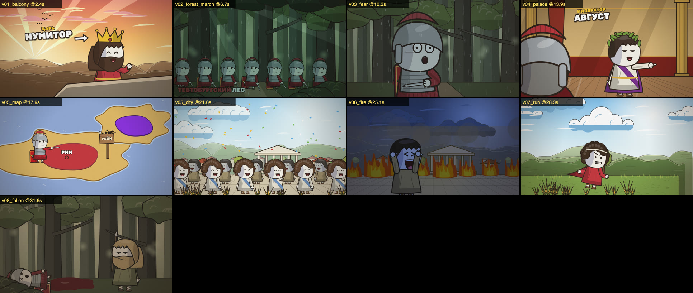

# toon-explainer

Скилл для агента: превращает сценарий-раскадровку в мультяшное видео-эссе в стиле исторических и научных YouTube-каналов. Персонажи с «бобовыми» головами в ракурсе 3/4, живописные фоны с передним планом, жирный леттеринг, карты, толпы, огонь, дождь, наезды камеры.

**Сценарий → JSON-спека → детерминированный рендер на Canvas (Playwright) → MP4.**



## Установка

Требуются [uv](https://docs.astral.sh/uv/), `ffmpeg` и Chromium для Playwright:

```sh
uv run --with playwright playwright install chromium
```

Чтобы агент находил скилл, положи или прилинкуй папку в `.claude/skills/toon-explainer` (Claude Code) или `.agents/skills/` своего проекта.

## Быстрый старт

```sh
python3 scripts/script2spec.py film/script.md --out film/spec.json        # раскадровка → скелет спеки + .srt
python3 scripts/spec.py film/spec.json                                     # валидация
uv run --with playwright python scripts/render.py film/spec.json --sheet film/sheet.jpg
uv run --with playwright python scripts/render.py film/spec.json --serve   # просмотр в браузере
uv run --with playwright python scripts/render.py film/spec.json --out film/final.mp4 --audio vo.mp3 --workers 4
```

Примеры:
- `examples/v2_showcase` — главные возможности;
- `examples/calendar_445` — короткий фильм;
- `examples/grammar` — каталог рецептов шотов;
- `examples/character_sheet` — ракурсы, эмоции, позы.

## Документация

- [SKILL.md](SKILL.md) — маршрут задач и правила производства
- [references/01-reference-breakdown.md](references/01-reference-breakdown.md) — замеры стиля референса
- [references/02-visual-grammar.md](references/02-visual-grammar.md) — какой шот под какую реплику
- [references/03-spec-reference.md](references/03-spec-reference.md) — полный контракт спеки
- [references/04-ai-assets.md](references/04-ai-assets.md) — гибрид с ИИ-картинками
- [references/05-workflow.md](references/05-workflow.md) — от сценария до видео, QA

## Тесты

```sh
uv run --with pytest --with playwright --with pillow --with numpy pytest tests -q
```

Шрифт Rubik распространяется по лицензии SIL OFL 1.1 (`scripts/engine/lib/fonts/OFL-Rubik.txt`).
